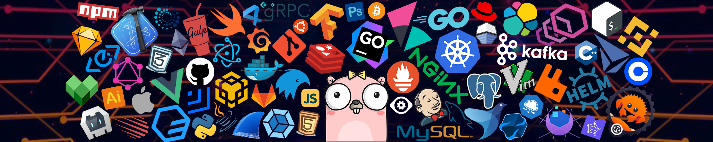

  

  

  <strong>Backend Developer</strong> focused on building scalable APIs, efficient database systems, and reliable backend architectures. Passionate about problem-solving, clean code, and continuous learning. Experienced with <strong>Django</strong>, <strong>Django REST Framework</strong>, <strong>FastAPI</strong>, databases, and modern software development practices.

---

### 📊 What I Build

<table>
  <tr>
    <td width="50%" valign="top">
      <ul>
        <li>🔌 <strong>Scalable REST APIs</strong></li>
        <li>🔐 <strong>Authentication & Authorization systems</strong></li>
        <li>⚡️ <strong>Asynchronous backend services</strong></li>
        <li>🗄️ <strong>Database-driven applications</strong></li>
        <li>🐳 <strong>Dockerized production environments</strong></li>
        <li>📊 <strong>Background jobs with Celery & Redis</strong></li>
      </ul>
    </td>
    <td width="50%" valign="top">
      <ul>
        <li>🤖 <strong>NLP & Machine Learning applications</strong></li>
        <li>🧠 <strong>LLM Integration</strong></li>
        <li>💬 <strong>Intelligent Chatbots</strong></li>
        <li>🎯 <strong>Recommendation Systems</strong></li>
        <li>🚀 <strong>Production deployment & monitoring</strong></li>
      </ul>
    </td>
  </tr>
</table>

---

### 🛠️ Tech Stack

<table>
  <tbody>
    <tr>
      <td width="25%"><strong>💻 Programming Languages</strong></td>
      <td>
        
        
        
        
        
        
      </td>
    </tr>
    <tr>
      <td width="25%"><strong>🌐 Web Development</strong></td>
      <td>
        
        
      </td>
    </tr>
    <tr>
      <td width="25%"><strong>📱 Mobile / Backend</strong></td>
      <td>
        
        
        
        
        
      </td>
    </tr>
    <tr>
      <td width="25%"><strong>🗄️ Databases</strong></td>
      <td>
        
        
        
        
      </td>
    </tr>
    <tr>
      <td width="25%"><strong>☁️ Cloud & DevOps</strong></td>
      <td>
        
        
        
        
        
      </td>
    </tr>
    <tr>
      <td width="25%"><strong>🌐 Web Servers & Proxy</strong></td>
      <td>
        
        
      </td>
    </tr>
    <tr>
      <td width="25%"><strong>📈 Monitoring & Logging</strong></td>
      <td>
        
        
        
        
      </td>
    </tr>
    <tr>
      <td width="25%"><strong>⚙️ Tools / Environment</strong></td>
      <td>
        
        
        
        
        
        
      </td>
    </tr>
  </tbody>
</table>

---

### 🚀 Featured Projects

<table>
  <thead>
    <tr>
      <th>Project</th>
      <th>Technologies</th>
      <th>Key Features</th>
      <th>Link</th>
    </tr>
  </thead>
  <tbody>
    <tr>
      <td><strong>Online Quiz System</strong></td>
      <td>
        <code>Python</code> 
        <code>Django</code> 
        <code>PostgreSQL</code> 
        <code>HTML / CSS</code> 
        <code>JavaScript</code>
      </td>
      <td>
        <ul>
          <li>Role (Student & Teacher) Based Registration & Authentication</li>
          <li>Create and assign quizzes on time and Quiz duration for Batches</li>
          <li>Start quizzes on time</li>
          <li>Student can attend quiz on time in their Quiz</li>
          <li>Automatically submit quiz after time is finished</li>
          <li>Student can see previous, current, and upcoming quizzes</li>
          <li>Control result publishing by teacher</li>
          <li>Student can see their result</li>
        </ul>
      </td>
      <td align="center">
        
      </td>
    </tr>
    <tr>
      <td><strong>Money Management</strong></td>
      <td>
        <code>Flutter</code> 
        <code>Sqflite</code>
      </td>
      <td>
        <ul>
          <li>Track income & expenses, view reports, manage budgets</li>
        </ul>
      </td>
      <td align="center">
        
      </td>
    </tr>
    <tr>
      <td><strong>Bank Management System</strong></td>
      <td>
        <code>Python</code> 
        <code>Tkinter</code> 
        <code>MySQL</code>
      </td>
      <td>
        <ul>
          <li>Role-based Registration & Authentication (Employee & Customer)</li>
          <li>Create Customer and Employee accounts and store information</li>
          <li>Searching employee and customer information</li>
          <li>Balance Withdrawal and Deposit</li>
          <li>List of Balance Withdrawals and Deposits</li>
          <li>Customer and Admin panels</li>
        </ul>
      </td>
      <td align="center">
        
      </td>
    </tr>
  </tbody>
</table>

---

  <h3>✨ Happy Coding ✨</h3>
  

    
    &nbsp;&nbsp;&nbsp;&nbsp;
    
    &nbsp;&nbsp;&nbsp;&nbsp;
    
  

